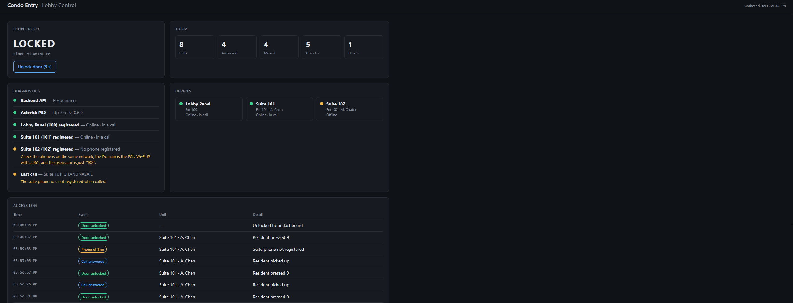
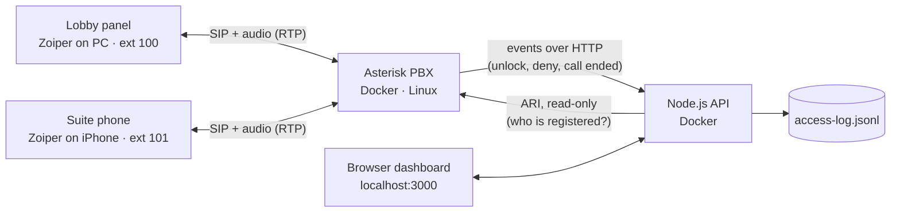

# Condo Entry

A software-only **telephone entry system** for condo lobbies. A visitor at the lobby panel calls a suite, the resident answers on their phone and presses **9** to unlock the door (or **0** to deny). Every call and entry is logged, and a web dashboard shows door status, the access log, and live diagnostics for every device.

Built to learn how intercom / telephone-entry products work end to end: SIP telephony on Linux, a Node.js backend, and the installer-facing documentation needed to support it in the field.



## How it works



1. The lobby (ext 100) dials a suite (ext 101–109). Asterisk rings the resident's phone.
2. While the call is up, the resident presses **9** → the dialplan calls the API → the door unlocks for 5 seconds and the event is logged. **0** logs a denied entry.
3. When the call ends, its result (`ANSWER`, `NOANSWER`, `CANCEL`, `CHANUNAVAIL`, …) is logged.
4. The dashboard polls the API every 3 seconds. The API asks Asterisk over **ARI** which phones are registered and turns that into pass / warn / fail checks, each with a plain-English fix.

## Features

- Lobby-to-suite calling over SIP with two-way audio
- Press 9 to unlock / 0 to deny, handled only on the resident's side of the call
- Door auto-relocks after 5 seconds, like a real electric strike
- Access log of every call, unlock and denial
- Dashboard: door status, remote unlock, daily counts, access log, device status
- Diagnostics panel with installer-friendly fixes for each failed check
- Everything runs in Docker with one command

## Stack

| Piece | Technology |
|---|---|
| Phone system | Asterisk 20 (PJSIP), Ubuntu 24.04, Docker |
| Backend | Node.js 20, no external dependencies |
| Asterisk → backend | Dialplan `System(curl …)` on DTMF feature codes |
| Backend → Asterisk | ARI (Asterisk REST Interface), read-only user |
| Phones | Zoiper (PC as lobby, iPhone as suite) |

## Quick start

Full instructions: **[docs/setup-guide.md](docs/setup-guide.md)**

```bash
# 1. Put your PC's Wi-Fi IPv4 address in config/pjsip.conf (external_*_address)
# 2. Start everything
docker compose up -d --build
# 3. Register softphones to <PC_IP>:5061  (ext 100 lobby, ext 101 suite)
# 4. Open the dashboard
http://localhost:3000
```

## Project structure

```
condo-entry/
├── docker-compose.yml      # asterisk + api containers
├── Dockerfile              # Asterisk image
├── config/                 # Asterisk config (mounted into the container)
│   ├── pjsip.conf          #   phones / extensions and NAT settings
│   ├── extensions.conf     #   dialplan: calling, 9/0 handling, call logging
│   ├── features.conf       #   maps keys 9 and 0 to unlock / deny
│   ├── http.conf, ari.conf #   ARI for the dashboard (read-only)
│   └── rtp.conf            #   audio port range
├── api/                    # Node.js backend + dashboard
│   ├── server.js
│   ├── residents.json      #   extension → suite / resident name
│   └── public/index.html   #   dashboard
└── docs/
    ├── setup-guide.md
    ├── troubleshooting.md
    └── knowledge-base.md
```

## Documentation

- **[Setup guide](docs/setup-guide.md)**: install from scratch and verify each step
- **[Troubleshooting guide](docs/troubleshooting.md)**: symptom → cause → fix, written for installers; built from real problems hit during this build
- **[Knowledge base](docs/knowledge-base.md)**: short how-to articles (add a suite, change a password, read diagnostics, export the log)

## Security notes

This is a demo. The SIP and ARI passwords in the config are placeholders and must be changed before using it anywhere but a home network.

- ARI uses a **read-only** account, and port 8088 is **not** published outside Docker.
- The API has no authentication. Anyone who can reach port 3000 can unlock the door. A real deployment needs login on the dashboard and on `/api/door*`.
- SIP runs over UDP without encryption. Production should use TLS for signalling and SRTP for audio.

## What I'd add next

- Authentication on the dashboard and API
- TLS / SRTP
- A real relay output (e.g. GPIO on a Raspberry Pi) instead of a simulated door
- A Flutter resident app that receives the call and shows an Unlock button
- A database (SQLite / MongoDB) instead of a log file, plus resident management in the dashboard
